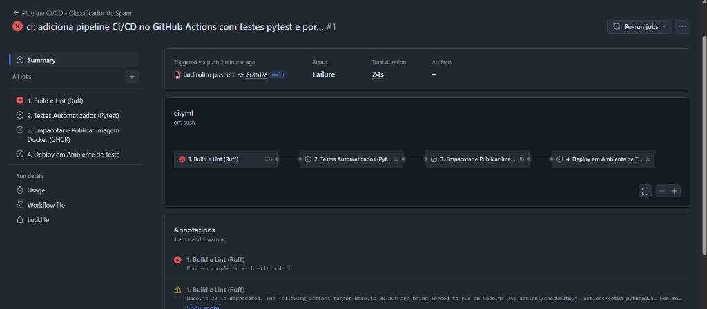
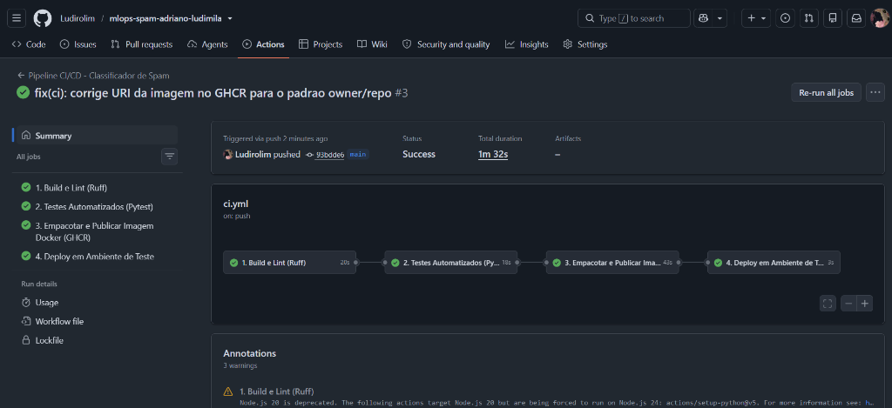

# Classificador de Spam — Documentação da Dupla

Repositório da atividade **"Do notebook à produção"** do componente curricular **MLOps e Deploy**.

---

## 1. O que foi construído

Construímos uma solução completa e empacotada em container para disponibilizar em produção um modelo de Machine Learning (TF-IDF + Regressão Logística treinado no `scikit-learn`) capaz de classificar mensagens em português como `spam` ou `nao_spam`:

1. **API REST de Inferência (`app/main.py`)**:
   - Carrega o artefato do modelo (`model/modelo.joblib`) uma única vez na inicialização do serviço.
   - **`GET /health`**: Endpoint público de monitoramento que retorna o estado do serviço (`status: "ok"`), a versão do modelo (`versao`) e o ambiente atual (`ambiente`), sem exigir autenticação.
   - **`POST /predict`**: Endpoint protegido que recebe uma mensagem de texto (`{"texto": "..."}`), valida o cabeçalho de autenticação `X-API-Key`, rejeita textos vazios ou compostos apenas por espaços em branco (erro `4xx`) e retorna o rótulo predito (`spam` ou `nao_spam`), a probabilidade associada e a versão do modelo que respondeu.
   - **`GET /`**: Entrega a interface web diretamente pela aplicação, simplificando a operação e evitando bloqueios de CORS entre origens distintas.

2. **Página Web de Testes (`app/static/index.html`)**:
   - Interface visual para interação com a API em tempo real.
   - Consulta automaticamente os endpoints `/health` e `/metrics` para exibir os selos de **versão do modelo**, **ambiente**, **estado do serviço** (`Serviço OK` ou `Serviço Indisponível`) e o **Painel de Operação** (`Requisições`, `Erros 5xx` e `Latência média`).
   - Possui campo de entrada do tipo senha para o usuário informar a `X-API-Key` em tempo de uso (**nenhuma credencial fica salva ou embutida no código-fonte da página**).
   - Inclui área de texto para a mensagem, botão **Classificar** e botões com **exemplos prontos** (*Ex. spam* e *Ex. comum*).
   - Exibe o resultado com destaque visual por classe, barra de probabilidade, tempo de resposta (latência em `ms`), versão do modelo e mensagens amigáveis em caso de falha (sem expor códigos internos de erro ao usuário).

3. **Empacotamento com Docker (`Dockerfile` e `.dockerignore`)**:
   - Imagem containerizada baseada em `python:3.12-slim` garantindo reprodutibilidade entre qualquer máquina e ambiente de produção.
   - Isolamento de segredos e arquivos desnecessários via `.dockerignore` (impedindo que `.env`, `.venv/` e `.git/` entrem na imagem).

4. **Implantação em Cluster Kubernetes Local (`k8s/`)**:
   - **`k8s/configmap.yaml` (`ConfigMap`)**: Armazena as configurações não sensíveis (`APP_ENV` e `MODEL_VERSION`).
   - **`k8s/secret.yaml` (`Secret`)**: Armazena de forma isolada o segredo de autenticação (`API_KEY`).
   - **`k8s/deployment.yaml` (`Deployment`)**: Gerencia 2 réplicas (*Pods*) da imagem `mlops-spam:v1` com `imagePullPolicy: IfNotPresent`, injetando as variáveis do `ConfigMap` e do `Secret` e monitorando a saúde dos containers via `readinessProbe` e `livenessProbe` no endpoint `/health`.
   - **`k8s/service.yaml` (`Service`)**: Expõe e balanceia o tráfego interno na porta `8000` entre as réplicas ativas do deployment.

---

## 2. Tecnologias escolhidas e justificativa

| Camada | Tecnologia | Justificativa da escolha |
|---|---|---|
| **Linguagem & Runtime** | **Python 3.11+ / 3.12** | Compatibilidade nativa com o ecossistema de ciência de dados (`scikit-learn` e `joblib`) utilizado no treinamento do modelo. |
| **Framework da API** | **FastAPI (`0.115.6`) + Pydantic** | Alta performance, validação automática de payloads JSON (garantindo rejeição de entradas inválidas com códigos `4xx`) e geração automática de documentação OpenAPI (`/docs`). |
| **Servidor ASGI** | **Uvicorn (`0.34.0`)** | Servidor ASGI leve, rápido e padrão de mercado para execução de aplicações FastAPI tanto localmente quanto em containers. |
| **Machine Learning** | **scikit-learn (`1.8.0`) + Joblib** | Versão exata fixada (`1.8.0`) para garantir total compatibilidade na desserialização do pipeline salvo em `model/modelo.joblib`. |
| **Front-end (Página Web)** | **HTML5, CSS3 e JavaScript (Vanilla)** | Sem necessidade de *build step* pesado ou dependências extras de Node.js. Servir a página diretamente pelo FastAPI unifica o deploy em um único serviço e elimina falhas de CORS. |
| **Containerização** | **Docker (`python:3.12-slim`)** | Garante que o serviço rode de forma idêntica em qualquer ambiente com todas as dependências na versão exata, sem gravar segredos na imagem. |
| **Orquestração** | **Kubernetes (Docker Desktop + `kubectl`)** | Alta disponibilidade com múltiplas réplicas, *self-healing* via probes em `/health` e separação declarativa de configuração (`ConfigMap`) e segredos (`Secret`). |
| **Hospedagem em Nuvem** | **Render** | Integração contínua direta com o GitHub (deploy automático a partir da branch `main`) e gerenciamento seguro de variáveis de ambiente e segredos fora do código. |

---

## 3. Variáveis de ambiente e segurança

Toda a configuração do sistema é feita via variáveis de ambiente, seguindo as práticas de **12-Factor App** e segurança de MLOps:

| Variável | Obrigatória | Valor padrão (fallback) | Descrição |
|---|---|---|---|
| `APP_ENV` | Sim | `dev` | Identifica o ambiente de execução (`dev` localmente, `test` no ambiente online). |
| `MODEL_VERSION` | Sim | `v1` | Identifica a versão do modelo em execução retornada por `/health` e `/predict`. |
| `API_KEY` | Sim | *(vazio)* | Segredo exigido no cabeçalho `X-API-Key` para autorizar chamadas ao endpoint `POST /predict`. |
| `MODEL_PATH` | Não | `model/modelo.joblib` | Caminho opcional para o arquivo `.joblib` do modelo. |

### O que muda entre `APP_ENV=dev` e `APP_ENV=test`?
- **`APP_ENV=dev` (Ambiente Local de Desenvolvimento)**:
  - Executado na máquina da dupla (via `.venv` ou container Docker local), lendo variáveis do arquivo local `.env` (que é ignorado pelo Git via `.gitignore` e pelo Docker via `.dockerignore`).
  - Permite validar rapidamente alterações de código e contrato antes do envio ao repositório.
- **`APP_ENV=test` (Ambiente Online / Homologação na Nuvem)**:
  - Executado no provedor de nuvem (Render), acessível publicamente via HTTPS.
  - As variáveis e o segredo `API_KEY` são injetados diretamente pelo painel seguro da plataforma de hospedagem, sem existência de arquivo `.env` no repositório.
  - O endpoint `/health` passa a reportar `"ambiente": "test"`, permitindo que a interface web e ferramentas externas confirmem que estão consumindo o ambiente publicado.

> **Nota de Segurança:** Nenhum segredo, senha ou chave de API real é armazenado no código-fonte, na imagem Docker, na página HTML ou nesta documentação. O arquivo `.env` está listado no `.gitignore` e no `.dockerignore` para impedir qualquer envio acidental ao controle de versão ou inclusão na imagem.

---

## 4. Como rodar localmente (com Python / `.venv`)

### Pré-requisitos
- **Python**: versão `3.11` ou superior (compatível com `scikit-learn==1.8.0`).
- **Git** instalado.

### Passo a passo

1. **Clonar o repositório**:
   ```bash
   git clone https://github.com/Ludirolim/mlops-spam-adriano-ludimila.git
   cd mlops-spam-adriano-ludimila
   ```

2. **Criar e ativar o ambiente virtual**:
   - No **Windows (PowerShell)**:
     ```powershell
     python -m venv .venv
     .venv\Scripts\activate
     ```
   - No **Linux / macOS**:
     ```bash
     python3 -m venv .venv
     source .venv/bin/activate
     ```

3. **Instalar as dependências**:
   ```bash
   pip install -r requirements.txt
   ```

4. **Configurar as variáveis de ambiente locais**:
   Copie o arquivo `.env.example` para `.env` e defina a sua chave local no campo `API_KEY`:
   - No **Windows (PowerShell)**:
     ```powershell
     Copy-Item .env.example .env
     ```
   - No **Linux / macOS**:
     ```bash
     cp .env.example .env
     ```
   *(Edite o arquivo `.env` gerado localmente caso deseje alterar o valor de `API_KEY`.)*

5. **Iniciar o servidor da API e Página Web**:
   ```bash
   uvicorn app.main:app --reload
   ```

6. **Acessar e testar no navegador**:
   - **Página Web Interativa**: `http://localhost:8000/`
   - **Documentação Swagger (OpenAPI)**: `http://localhost:8000/docs`
   - **Healthcheck**: `http://localhost:8000/health`

---

## 5. Como rodar com Docker (Container)

### Pré-requisitos
- **Docker** / **Docker Desktop** instalado e em execução.

### Passo a passo

1. **Construir a imagem Docker (`docker build`)**:
   Na raiz do projeto (onde está o `Dockerfile`), execute:
   ```bash
   docker build -t mlops-spam:v1 .
   ```

2. **Executar o container (`docker run`)**:
   - **Opção A — Usando o arquivo `.env` local** (criado a partir do `.env.example`):
     ```bash
     docker run -d -p 8000:8000 --env-file .env --name classificador-spam mlops-spam:v1
     ```
   - **Opção B — Passando as variáveis diretamente na linha de comando** *(substitua `<SUA_CHAVE_DE_API>` pela chave desejada)*:
     ```bash
     docker run -d -p 8000:8000 \
       -e APP_ENV=dev \
       -e MODEL_VERSION=v1 \
       -e API_KEY=<SUA_CHAVE_DE_API> \
       --name classificador-spam \
       mlops-spam:v1
     ```

3. **Verificar que o container está rodando**:
   ```bash
   docker ps
   ```
   E acesse no navegador:
   - **Página Web**: `http://localhost:8000/`
   - **Healthcheck**: `http://localhost:8000/health`
   - **Swagger UI**: `http://localhost:8000/docs`

4. **Comandos úteis de gerenciamento do container**:
   - Ver logs do container:
     ```bash
     docker logs classificador-spam
     ```
   - Parar e remover o container:
     ```bash
     docker stop classificador-spam
     docker rm classificador-spam
     ```

### Exemplos de teste via `curl` (Local ou Docker)

- **Consultar saúde do serviço (`GET /health`)**:
  ```bash
  curl http://localhost:8000/health
  ```

- **Classificar mensagem (`POST /predict`)**:
  *(Substitua `<SUA_CHAVE_DE_API>` pelo valor configurado na variável `API_KEY` do seu ambiente)*
  ```bash
  curl -X POST http://localhost:8000/predict \
    -H "Content-Type: application/json" \
    -H "X-API-Key: <SUA_CHAVE_DE_API>" \
    -d '{"texto": "Parabéns! Você ganhou um prêmio, clique no link"}'
  ```

---

## 6. Como implantar no Kubernetes (Cluster Local — Etapa 2)

### Pré-requisitos
- **Docker Desktop** com **Kubernetes habilitado** (`kubeadm`) e contexto `docker-desktop` ativo.
- **`kubectl`** disponível no terminal.

### Roteiro de implantação (Deploy)

1. **Verificar o contexto e o nó do cluster**:
   ```bash
   kubectl config current-context
   kubectl get nodes
   ```
   *(O nó `docker-desktop` deve estar com status `Ready`.)*

2. **Construir a imagem versionada `v1` localmente**:
   ```bash
   docker build -t mlops-spam:v1 .
   ```

3. **Aplicar os manifestos do Kubernetes (`ConfigMap`, `Secret`, `Deployment` e `Service`)**:
   ```bash
   kubectl apply -f k8s/
   ```

4. **Verificar se os recursos e os Pods estão em execução (`Running` e `1/1 READY`)**:
   ```bash
   kubectl get pods,svc,configmap,secret
   ```

5. **Expor o serviço localmente via `port-forward` para validação**:
   ```bash
   kubectl port-forward svc/spam-api-service 8000:8000
   ```

6. **Validar a aplicação rodando no cluster**:
   - **Página Web**: `http://localhost:8000/`
   - **Healthcheck**: `http://localhost:8000/health`
   - **Teste de predição via `curl`**:
     ```bash
     curl -X POST http://localhost:8000/predict \
       -H "Content-Type: application/json" \
       -H "X-API-Key: chave-ficticia-123" \
       -d '{"texto": "Parabéns! Você ganhou um prêmio, clique no link"}'
     ```

7. **Comandos úteis de operação e limpeza no cluster**:
   - Ver logs dos Pods:
     ```bash
     kubectl logs -l app=spam-api
     ```
   - Remover todos os recursos implantados:
     ```bash
     kubectl delete -f k8s/
     ```

---

## 7. Pipeline CI/CD e Portões de Qualidade (Etapa 3)

O projeto possui um pipeline automatizado de Integração e Entrega Contínua configurado no **GitHub Actions** em [`.github/workflows/ci.yml`](.github/workflows/ci.yml), executado automaticamente a cada `push` ou `pull_request` na branch `main`.

### Etapas do Pipeline (`build → testes → empacotamento → deploy`)

1. **`build` (1. Build e Lint com Ruff)**:
   - Cria um ambiente Linux limpo (`ubuntu-latest`) com Python `3.12`.
   - Instala as dependências do `requirements.txt` e valida se o modelo `modelo.joblib` e a aplicação FastAPI carregam sem erros (*Smoke Build*).
   - Executa a análise estática de código com `ruff check app/ tests/ model/`.
2. **`testes` (2. Testes Automatizados com Pytest)** — `needs: build`:
   - Executa a suíte de testes automatizados em [`tests/test_api.py`](tests/test_api.py) com `pytest -v`.
3. **`empacotamento` (3. Empacotar e Publicar Imagem Docker no GHCR)** — `needs: testes`:
   - Constrói a imagem Docker a partir do `Dockerfile`.
   - Autentica no **GitHub Container Registry (`ghcr.io`)** usando o `GITHUB_TOKEN` nativo e publica a imagem versionada com as tags `:v1` e `:<commit-sha>`.
4. **`deploy` (4. Deploy em Ambiente de Teste)** — `needs: empacotamento`:
   - Aciona automaticamente o *Deploy Hook* do ambiente de teste no Render (lendo o segredo `${{ secrets.DEPLOY_HOOK_URL }}` sem expor credenciais no código).

### Portões de Qualidade (*Quality Gates*) e Critérios de Aprovação

O pipeline implementa **3 portões de qualidade** encadeados via `needs:` — se qualquer portão falhar, o pipeline é interrompido imediatamente e as etapas seguintes são bloqueadas:

| Portão de Qualidade | Ferramenta / Comando | Critério de Aprovação |
|---|---|---|
| **Portão 1: Build Limpo & Lint** | `pip install` + `ruff check` | Todas as dependências devem instalar sem erro, o modelo `.joblib` deve carregar e o código Python não pode conter erros de sintaxe ou falhas críticas apontadas pelo Ruff. |
| **Portão 2: Testes Automatizados de Contrato e Modelo** | `pytest -v` (`tests/test_api.py`) | Todos os 5 testes devem passar:<br>1. `GET /health` retorna HTTP `200` com `status: "ok"`, `versao` e `ambiente`.<br>2. `POST /predict` classifica mensagem de spam como `"spam"` com probabilidade entre `0.0` e `1.0`.<br>3. `POST /predict` classifica mensagem comum como `"nao_spam"`.<br>4. `POST /predict` sem `X-API-Key` ou com chave errada retorna HTTP `401`.<br>5. `POST /predict` com texto vazio retorna erro `4xx` (`422`). |
| **Portão 3: Publicação Condicionada da Imagem** | `needs: testes` + `docker build` | A imagem Docker só é construída, publicada no `ghcr.io` e enviada para deploy se os Portões 1 e 2 forem aprovados (`100% verdes`). |

### Como rodar o Lint e os Testes Automatizados localmente

```bash
# Instalar ferramentas de teste e lint no ambiente virtual (.venv)
pip install pytest httpx ruff

# Rodar a análise de código (Portão 1)
ruff check app/ tests/ model/

# Rodar os testes automatizados da API (Portão 2)
pytest -v
```

### Evidências de Execução do Pipeline no GitHub Actions

1. **Execução com Falha (Portão de Qualidade bloqueando o avanço — Run `#1`)**:
   - O **Portão de Qualidade 1 (`1. Build e Lint - Ruff`)** detectou uma violação no linter e interrompeu imediatamente o pipeline, bloqueando a execução dos testes, do empacotamento Docker e do deploy:
   

2. **Execução com Sucesso (Todos os Portões de Qualidade Aprovados — Run `#3`)**:
   - Após a correção, todas as 4 etapas (`1. Build e Lint` → `2. Testes Automatizados` → `3. Empacotar e Publicar Imagem Docker` → `4. Deploy em Ambiente de Teste`) foram concluídas com sucesso (`100% verde`):
   

---

## 8. Observabilidade: Logs Estruturados e Métricas (Etapa 4)

A aplicação implementa os pilares de observabilidade (Aula 06):

1. **Logs Estruturados em JSON (`stdout`)**:
   - Cada requisição processada gera uma linha em JSON na saída padrão (`stdout`), contendo identificador único de rastreio (`id`), `hora`, `nivel` (`INFO`, `WARNING`, `ERROR`), `metodo`, `rota`, `status`, latência (`ms`), `versao` e `ambiente`.
   - Por segurança e privacidade, **nenhuma chave de API (`X-API-Key`) nem o conteúdo das mensagens dos usuários são gravados nos logs**.
   - Exemplo de log emitido:
     ```json
     {"hora": "19:45:12", "nivel": "INFO", "mensagem": "requisicao processada", "id": "a1b2c3d4", "metodo": "POST", "rota": "/predict", "status": 200, "ms": 8.42, "versao": "v1", "ambiente": "dev"}
     ```

2. **Métricas Operacionais (`GET /metrics`) e Painel de Operação**:
   - O endpoint `GET /metrics` retorna os contadores em memória da instância atual:
     ```json
     {
       "requisicoes": 50,
       "erros_4xx": 0,
       "erros_5xx": 0,
       "latencia_media_ms": 6.8,
       "spam": 28,
       "nao_spam": 22,
       "versao": "v1",
       "ambiente": "dev"
     }
     ```
   - O **Painel de Operação** na página web (`app/static/index.html`) consome `GET /metrics` automaticamente e permite disparar lotes de **50 requisições** para observar a evolução da latência média e do volume de tráfego.

---

## 9. URL Online (Publicação em Nuvem)

- **Repositório GitHub**: https://github.com/Ludirolim/mlops-spam-adriano-ludimila
- **Plataforma de Hospedagem**: Render (Web Service)
- **URL Pública da Aplicação (Página Web + API)**: `https://mlops-spam-adriano-ludimila.onrender.com` *(atualizar caso o subdomínio gerado no Render seja diferente)*
  - Healthcheck online: `https://mlops-spam-adriano-ludimila.onrender.com/health`
  - Métricas online: `https://mlops-spam-adriano-ludimila.onrender.com/metrics`
  - Documentação interativa online: `https://mlops-spam-adriano-ludimila.onrender.com/docs`

> **Observação sobre o plano gratuito do Render:** Após alguns minutos de inatividade, o serviço entra em modo de hibernação (*spin down*). A primeira requisição após esse período pode levar cerca de 30 a 50 segundos para responder enquanto o contêiner reinicia.

---

## 10. Quem fez o quê (Divisão de Tarefas da Dupla)

O trabalho foi realizado em dupla com versionamento colaborativo no GitHub:

- **Adriano**:
  - Implementação e alterações da API em `app/main.py` (carregamento de variáveis de ambiente, proteção de segurança com `X-API-Key`, validação de entrada, implementação dos endpoints `/health`, `/predict` e `/metrics` e integração com o modelo `modelo.joblib`).
  - Empacotamento da aplicação em container com Docker (`Dockerfile` e `.dockerignore`) e publicação online no Render.
  - Elaboração e atualização da documentação do projeto.

- **Ludimila**:
  - Desenvolvimento e alterações da página web em `app/static/index.html` (construção da interface visual conforme o modelo proposto, integração com `/health`, `/predict` e `/metrics`, exibição de probabilidades, latência, botões de exemplos prontos e mensagens amigáveis de erro).
  - Criação dos manifestos de implantação em Kubernetes (`k8s/configmap.yaml`, `k8s/secret.yaml`, `k8s/deployment.yaml` e `k8s/service.yaml`), validação no cluster local e documentação do roteiro de deploy.
  - Implementação dos testes automatizados com `pytest` (`tests/test_api.py`), logs estruturados em JSON e construção do pipeline de CI/CD com portões de qualidade no GitHub Actions (`.github/workflows/ci.yml`).
